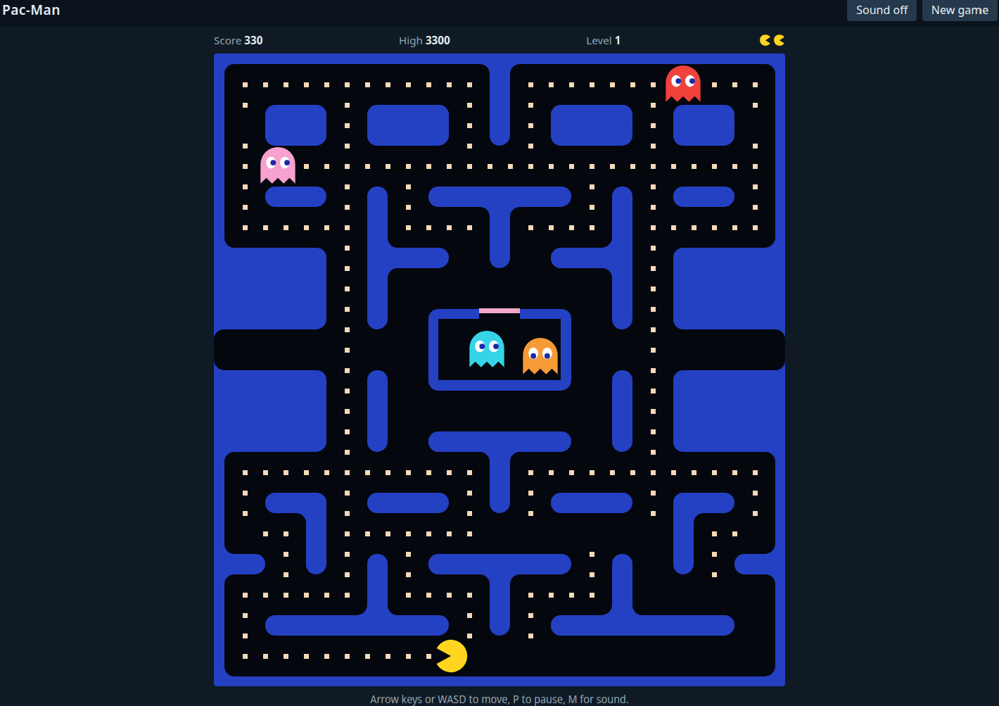

# Pac-Man

A simple, standalone browser version of the classic arcade maze game.

**[Play it online](https://onckelinx.github.io/pacman/)**. You need a keyboard: move with the arrow keys or WASD. P pauses and M turns the sound on or off.

**Or play offline:** download this repository (**Code → Download ZIP**), unzip it and double-click `index.html`. There is nothing to install.

- The classic maze, four ghosts that each hunt in their own way, fruit, and levels that get faster
- Graphics and sound are generated in the browser, so there are no image or audio files
- Plain HTML, CSS and JavaScript, with no dependencies

Open `tests/index.html` in a browser to run the tests.

This is an unofficial fan project, not affiliated with or endorsed by Bandai Namco Entertainment, which owns the PAC-MAN trademark. The code is released under the [MIT License](LICENSE), which does not cover that trademark.
